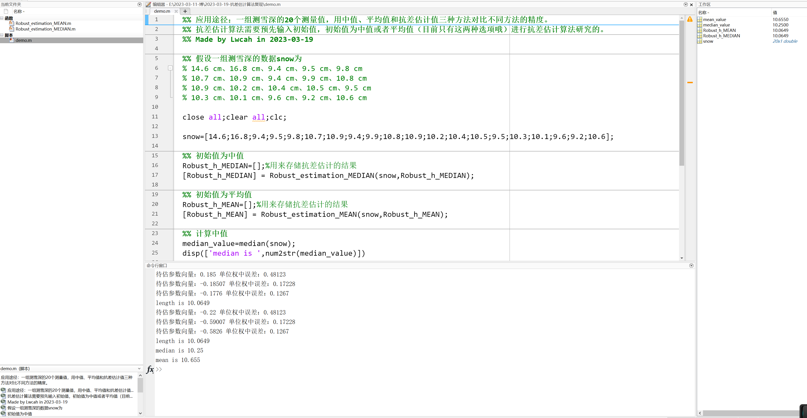

# MATLAB | Anti-Skew Estimation Algorithm | Includes Data and Calculation Results | Direct Starter

Two days passed without updates, aside from eating and drinking, I simply replicated the innovations of this article. Traditionally, it is a discipline in engineering - surveying and mapping, which naturally piques my interest in advanced data processing theories such as high-precision differential adjustments. During the reading of literature, I stumbled upon an article that caught my attention, so I spent two days trying to reproduce it.
1. Article Overview
The article's DOI: 10.1016/j. Asr.2022.10.014
This article discusses a new method for remote sensing to infer snow depth. While selecting values for daily numerous snow depth inversions, a new algorithm for robust estimation was applied to obtain robust estimation values. The robust estimation values were also compared with median and mean methods. Although the authors did not make the robust estimation algorithm's code open-source, their theoretical explanations were very clear and complete, allowing for a full reproduction.
2. What is a Robust Estimation Algorithm?
Robust estimation algorithms are used to estimate the true values of data when there are outliers. Common robust estimation methods include least squares estimation, median estimation, M-estimator, LMS estimation, etc. Least squares estimation is a common linear regression method that estimates the true values of data by minimizing the residual sum of squares. However, it can be easily affected by outliers in the data. Median estimation is a method based on the median of the data to estimate the true values, which has relatively less impact from outliers. However, it can also be affected by uneven data distribution. M-estimator is a method based on maximum likelihood estimation that estimates the true values of data by maximizing the likelihood function, which can resist the impact of outliers better. LMS estimation is a method based on minimum absolute error and estimates the true values of data by minimizing the absolute error, which can also obtain accurate results when there are outliers. In summary, robust estimation algorithms can effectively improve the robustness of data and enhance the accuracy and reliability of data analysis.
3. What are the applied disciplines?
Under normal circumstances, various disciplines are applicable. For example, if 10 measurement values are required with an average and a median for comparison, then the anti-difference estimation value can also be used for comparison.
Application Route: A set of 20 snow depth measurements is used to compare the precision of three methods - median, mean, and robust estimation. The robust estimation algorithm requires an initial value to be inputted, which can either be the median or the mean (currently, only these two options are available).
4. Reproduction effect
The original author used a snow depth value, so I also created several snow depth values for data processing and analysis here. The main purpose is to reproduce it using the robust M-estimation.
Assume a set of snow depth data snow is:
14.6 cm, 16.8 cm, 9.4 cm, 9.5 cm, 9.8 cm
10.7 cm, 10.9 cm, 9.4 cm, 9.9 cm, 10.8 cm
10.9 cm, 10.2 cm, 10.4 cm, 10.5 cm, 9.5 cm
10.3 cm, 10.1 cm, 9.6 cm, 9.2 cm, 10.6 cm

Through the output of the command line below, it can be observed that:
- The initial value calculated by the median and mean estimation algorithm is 10.0649 and 10.0649 respectively.
- The median of this set of snow depth data is 10.25.
- The average of this set of snow depth data is 10.655.

Video tutorial attached:
To view this video please enable JavaScript, and consider upgrading to a web browser that supports HTML5 video.

Video Player is loading.
Play Video
Mute
Current Time 0:00
Duration 0:16
Loaded: 0.00%
0:00
Stream Type LIVE
Seek to live, currently behind live
Remaining Time -0:16
1x  
Playback Rate  
ChaptersChapters  
Descriptionsdescriptions off, selected  
Subtitlessubtitles settings, opens subtitles settings dialog  
subtitles off, selected  
Audio Track  
Picture-in-PictureFullscreen  
This is a modal window.  
Beginning of dialog window. Escape will cancel and close the window.  
TextColorWhiteBlackRedGreenBlueYellowMagentaCyanTransparencyOpaqueSemi-TransparentBackgroundColorBlackWhiteRedGreenBlueYellowMagentaCyanTransparencyOpaqueSemi-TransparentTransparentWindowColorBlackWhiteRedGreenBlueYellowMagentaCyanTransparencyTransparentSemi-TransparentOpaque  
Font Size50%75%100%125%150%175%200%300%400%Text Edge StyleNoneRaisedDepressedUniformDropshadowFont FamilyProportional Sans-SerifMonospace Sans-SerifProportional SerifMonospace SerifCasualScriptSmall Caps  
Reset restore all settings to the default valuesDone  
Close Modal DialogEnd of dialog window.  

## Images

<!-- PAYMENT_BLOCK -->

## Get this dataset

- Payment link (Stripe): [Buy now](https://buy.stripe.com/3cs8yP7sY87d0vu9AB)
- Payment QR code: 

<!-- /PAYMENT_BLOCK -->
